# Log Ingestion Engine

[](https://github.com/johneliud/log_ingestion_engine/actions/workflows/ci.yml)

A Go service that accepts logs over HTTP, validates and enriches them, routes them through RabbitMQ, stores them in SQLite and reports metrics.

## Architecture

The source diagram lives in [`internal/dashboard/architecture.mmd`](internal/dashboard/architecture.mmd); the home page at `/` renders it with the vendored mermaid 11.6.0 library alongside the package responsibilities and nav links to the dashboard and metrics. Every component receives a single `ApplicationConfiguration` loaded from the configuration file and process environment.

```mermaid
flowchart LR
    client(["Clients"])

    subgraph ingress["HTTP ingress"]
        direction TB
        rateLimit["Rate limiter<br/>per IP, in-memory"]
        logsEndpoint["POST /logs"]
        validate["Validate batch<br/>body size + per-entry errors"]
    end

    rawQueue[("raw_logs<br/>bounded channel")]

    subgraph processing["Pipeline worker pool"]
        direction TB
        enrich["Enrich<br/>received_at · source_ip · environment"]
        route["Route<br/>service → destination rules"]
    end

    subgraph publishing["Publisher"]
        direction TB
        rabbitPublisher["RabbitMQ publisher<br/>persistent + confirms<br/>5s publish timeout<br/>auto-reconnect with backoff"]
        fallback[("Bounded in-memory fallback<br/>used while disconnected")]
    end

    broker[("RabbitMQ<br/>exchange_service1..3<br/>queue_service1..3<br/>routing key: log.write")]

    subgraph delivery["Consumers and storage"]
        direction TB
        amqpConsumer["AMQP consumers<br/>one per destination queue<br/>ack after stored"]
        fallbackConsumer["Fallback consumer"]
        batchWriter["Batch writer<br/>per-destination buffers<br/>retry with backoff"]
        sqlite[("SQLite<br/>logs_service1.db<br/>logs_service2.db<br/>logs_service3.db")]
        deadLetters[("Dead-letter NDJSON<br/>rotated by size")]
        replay["cmd/replay"]
    end

    client --> rateLimit --> logsEndpoint --> validate --> rawQueue
    rawQueue --> enrich --> route --> rabbitPublisher
    rabbitPublisher -->|"connected"| broker
    rabbitPublisher -->|"publish fails"| fallback
    broker -->|"deliver"| amqpConsumer
    fallback -->|"stored directly, never re-published"| fallbackConsumer
    amqpConsumer --> batchWriter
    fallbackConsumer --> batchWriter
    batchWriter -->|"stored"| sqlite
    batchWriter -->|"retries exhausted"| deadLetters
    deadLetters -.-> replay
    replay -.->|"replay"| sqlite
```



Clients pass through the rate limiter to `POST /logs`, where the batch is validated and pushed into the bounded `raw_logs` channel. Pipeline workers enrich and route each log before the publisher sends it to RabbitMQ; if publishing fails, the log enters the bounded fallback instead. Consumers write through the retrying batch writer into one SQLite database per destination, and logs whose retries are exhausted go to the dead-letter file for later replay.

## Clone

```bash
git clone https://github.com/johneliud/log_ingestion_engine.git
cd log_ingestion_engine
```

## Prerequisites

- Go 1.26 or newer (`go version`)
- Docker (only for RabbitMQ during development)

## Setup

1. Copy `configs/.env.example` to `.env` and replace the credential placeholders:

   ```bash
   cp configs/.env.example .env
   ```

Go dependencies resolve from `go.mod` automatically on the first build.

## Running

1. `go run ./cmd/server`. The server listens on `HTTP_PORT` (default `8080`) and shuts down cleanly on interrupt.
2. Confirm it is up with `curl -s -i localhost:8080`.
3. Configuration auto-loading: The file path is `.env` in the working directory overridable with `CONFIG_FILE_PATH`; values already set in the environment always win.

All settings come from environment variables with documented defaults in `configs/.env.example`; RabbitMQ credentials are required and the server fails fast with a readable error when a required value is missing or invalid including a malformed configuration file (a missing file is simply ignored).

## Client IP resolution

Client IP is taken from the first entry of `X-Forwarded-For` (trimmed, validated as an IP, ignoring an empty or invalid first entry) when a trusted proxy forwarded the request, otherwise from the socket address host, otherwise `"unknown"`. `X-Forwarded-For` is client-controlled and only honored when the request comes from a configured trusted proxy; without one, the socket address host is used. The same function is used by the rate-limit middleware and for capturing `source_ip`. All `"unknown"` callers share one bucket. The limiter is in-memory and single-instance (lost on restart).

## Dead letters and replay

After the configured write retries are exhausted (`RETRY_BACKOFFS`, default `1s,5s,10s`), the affected logs are appended to `DEAD_LETTER_PATH` (default `logs-failed.json`) as newline-delimited JSON containing the original log, the error message and the failure timestamp. A single writer goroutine serializes file I/O. When adding an entry would exceed `DEAD_LETTER_MAX_BYTES` (default 10 MB), the file is rotated to `logs-failed.1.json`, `logs-failed.2.json`, and so on.

Replay a dead letter file back into the destination SQLite databases (the logs are already enriched and routed):

```bash
go run ./cmd/replay                    # replays DEAD_LETTER_PATH
go run ./cmd/replay logs-failed.1.json # replays a rotated file
```

Replay stops at the first unreadable line so a corrupt file is never silently skipped. The command does not delete or truncate the replayed file; remove it after verifying the rows.

## RabbitMQ outages and reconnects

When a publish fails or the broker connection drops, the publisher logs a warning, marks itself disconnected and writes subsequent logs to a bounded in-memory fallback instead of blocking ingestion. The publisher retries the connection automatically using `RABBITMQ_RECONNECT_BACKOFFS` (default `1s,5s,10s,30s`, reusing the last delay after the list is exhausted) and resumes publishing once the broker returns.

Fallback logs are not re-published after reconnecting. They stay in the fallback channel and the fallback consumer stores them directly in SQLite while new logs go to RabbitMQ, so each accepted log follows exactly one path: broker or fallback. If the fallback fills before the broker returns, `Publish` reports and logs an error rather than dropping the log silently; during a sustained outage with more than the fallback capacity in flight, that is the only documented loss point.

## Metrics

The `internal/metrics` module is the single source of truth for every counter. It tracks total logs received, logs by level, logs by service, rate-limited requests, dead-lettered logs, write failures and queue backlog. A snapshot is returned by `Snapshot()` and used by every consumer of metrics; counter updates on the ingestion path stay cheap.

Two values are derived at snapshot time rather than stored:

- **`error_rate`**: the number of ERROR-level logs divided by the total number of logs received since the process started.
- **`throughput`**: the number of logs received in the last `METRICS_THROUGHPUT_WINDOW` seconds (default `1m`) divided by the window length in seconds. Logs older than the window are excluded from the throughput calculation but still count toward the cumulative total.

All counters are in memory and reset when the process restarts.

`GET /metrics` serves a human-readable metrics page: every counter is shown as a plain number, with the logs grouped by level and by service, refreshed every five seconds. `GET /metrics.json` serves the same snapshot as JSON and refreshes `queue_backlog` on every request: the three `queue_service*` queues are summed from the RabbitMQ management API (`RABBITMQ_MGMT_URL/api/queues`, bounded by `METRICS_BACKLOG_TIMEOUT`, default `2s`). If the URL is unset or the API fails, a warning is logged and a local fallback counter — defined as messages published minus messages stored, floored at zero — is reported instead. The response shape is documented in [`docs/api.md`](docs/api.md).

## Dashboard

`GET /dashboard` shows total logs, logs per second, error rate, queue backlog and the top five services by volume as plain numbers, refreshed every five seconds by polling `GET /metrics.json`. Throughput and error-rate history are kept client-side in the page and drawn with Chart.js 4.6.1, vendored at `internal/dashboard/static/js/chart.umd.js` and embedded — the page never loads a CDN and renders fully offline.

Typography is Space Grotesk, vendored as woff2 subsets under `internal/dashboard/static/fonts` together with its SIL Open Font License. It is the only font the pages use — sans-serif and monospace text alike — and no font is fetched from a CDN.

Styling is Tailwind CSS compiled ahead of time. After editing `internal/dashboard/static/css/input.css`, the pages `internal/dashboard/index.html` or `internal/dashboard/root.html`, or `internal/dashboard/static/js/app.js`, regenerate and commit the stylesheet with:

```bash
make dashboard-css
```

The target downloads the Tailwind v4.3.3 standalone CLI (linux-x64) into the git-ignored `bin/` on first use — no Node or npm required, and `go build` never depends on it.

## Tests

```bash
go test ./... -race
go vet ./...
gofmt -l .
```

Full instructions, package-by-package coverage and CI details are in [`docs/TESTING.md`](docs/TESTING.md).
