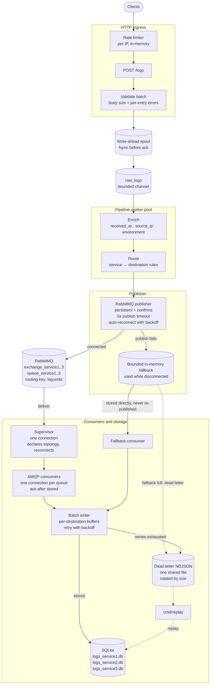

# Log Ingestion Engine

A Go service that receives batched JSON logs, validates, enriches, routes via RabbitMQ, stores in SQLite, and exposes metrics.



## Architecture

- **HTTP ingress** : rate‑limited `POST /logs` → validation → write‑ahead spool (fsync before 202) → bounded `raw_logs` channel (10 000 entries).
- **Pipeline** : N configurable workers enrich & route each log, then publish to RabbitMQ with per‑log confirm (default 5 s timeout).
- **Publisher** : single process, persistent connection, per‑log confirms, in‑memory fallback (10 000) when broker down.
- **Consumers** : one AMQP connection per destination, ack after store into per‑destination SQLite (`logs_service*.db`).
- **Batch writer** : one sink goroutine, per‑destination buffers, exponential retry; writes to SQLite; dead‑letter sink routes exhausted retries to a shared NDJSON file (rotated by size).
- **Spool** : durable log; every accepted batch is fsynced before the handler returns 202. Unacked entries are replayed on restart.
- **Dead‑letter** : single writer; entries exceeding `DEAD_LETTER_MAX_BYTES` (default 10 MB) are rotated (`*.1.json`, `*.2.json`, …).
- **Metrics** : in‑memory counters; `GET /metrics.json` snapshot; backlog refreshed from RabbitMQ management API every 2 s; event stream every 200 ms.
- **Frontend** : React + Vite, Chart.js, Space Grotesk from Google Fonts CDN, Mermaid diagram.

## Key decisions

- Spool fsync on the critical path guarantees 202 durability; it adds latency but prevents lost 202s.
- Publisher confirm loop is the throughput bottleneck; scaling workers helps up to ~11‑12 for 1 k logs/s.
- Bounded `raw_logs` channel back‑pressures into 503s when publishing slows; all‑or‑nothing at batch granularity.
- Graceful shutdown (30 s default): drain pipeline first; only if the period expires are remaining logs dead‑lettered and acked in the spool.
- `429` responses include a `Retry‑After` header (ceil seconds, min 1).
- Retries generate new `log_id`s, so a retried batch and a replayed spool entry are stored as distinct rows.
- Spool compaction only when every spooled ID has been acknowledged; under continuous traffic this is rare, so the spool can grow.

## Quickstart

```bash
git clone https://github.com/johneliud/log_ingestion_engine.git
cd log_ingestion_engine
cp configs/.env.example .env       # fill RABBITMQ_USER / RABBITMQ_PASS
go run ./cmd/server              # defaults to :8080
# frontend
cd frontend && npm install && npm run dev
```

## Graceful shutdown (30 s default)

1. HTTP server stops, waits for in‑flight requests.
2. Shutdown waits for running requests to finish.
3. Pipeline workers drain `raw_logs` until completion **or** grace period expires.
4. If the period expires, leftover logs are enriched, routed, written to the dead‑letter file, and acked in the spool.
5. Storage components are cancelled and awaited.
6. Batch writer flushes all destination buffers to SQLite; dead‑letter writer drains its queue.

## Rate limiting

- `RATE_LIMIT` requests/s per IP (default 1000).
- When a bucket is empty the request gets `429` with a `Retry‑After` header (whole seconds, min 1).
- Counters are in‑memory; buckets refill continuously.

## Tests

- 172 tests across 15 packages (`go test ./...`).
- Integration suite (`go test ./cmd/server -race -run TestIntegration`) exercises the full pipeline, fallback, shutdown, and dead‑letter rotation.
- Unit tests per package cover handler, spool, storage, pipeline, queue, ratelimit, router, metrics, model, ingest.

## Known limitations

- Single instance only (process‑local rate limiter, metrics, queue backlog).
- Metrics not persisted across restarts.
- No authentication on `POST /logs`.
- Credentials from `.env` / environment.
- No built‑in alerting.
- `queue_backlog` accuracy depends on RabbitMQ management API availability.
