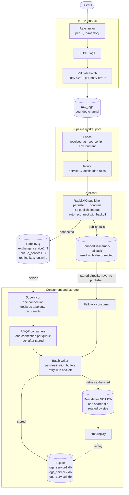

# Log Ingestion Engine

[](https://github.com/johneliud/log_ingestion_engine/actions/workflows/ci.yml)

A Go service that accepts logs over HTTP, validates and enriches them, routes them through RabbitMQ, stores them in SQLite and reports metrics.

## Architecture

The source diagram lives in [`frontend/public/architecture.mmd`](frontend/public/architecture.mmd) and is rendered by the React frontend on the home page alongside a project summary, the design decisions and nav links to the dashboard and metrics. Every component receives a single `ApplicationConfiguration` loaded from the configuration file and process environment.



Clients pass through the rate limiter to `POST /logs`, where the batch is validated and pushed into the bounded `raw_logs` channel. Pipeline workers enrich and route each log before the publisher sends it to RabbitMQ. If publishing fails, the log enters the bounded fallback instead.

A consumer supervisor keeps one broker connection for the per-destination consumers and replaces it with backoff when a subscription ends. Consumers write through the retrying batch writer into one SQLite database per destination, and logs whose retries are exhausted go to the shared dead-letter file for later replay.

## Concurrency model

- HTTP handlers are stateless; the only mutable state they touch is the rate-limiter registry and the bounded `raw_logs` channel (`pipeline.RawLogsQueue` push with a per-log send budget, the whole request answers `503` when a push times out).
- `PIPELINE_WORKER_COUNT` workers take batches from that one channel, enrich, route and publish each log, waiting for the broker confirm per log. They share one publisher whose bounded in-memory fallback and one fallback consumer drain it while disconnected.
- One consumer per destination queue holds its own AMQP connection; the supervisor owns one shared connection and replaces failed subscriptions with backoff.
- The batch writer is a single sink goroutine with per-destination buffers and one retry loop. The dead-letter writer is a single goroutine owning all file I/O. Metrics counters are mutex-guarded atomics-snapshot style.
- Shutdown walks these pieces in reverse order under one grace-period deadline (see `Graceful shutdown`).

## Clone

```bash
git clone https://github.com/johneliud/log_ingestion_engine.git
cd log_ingestion_engine
```

## Prerequisites

- Go 1.26 or newer (`go version`)
- Docker (only for RabbitMQ during development)
- Node.js 24 or newer and npm (`node --version`, `npm --version`) only needed to build or run the React frontend

## Setup

1. Copy `configs/.env.example` to `.env` and replace the credential placeholders. Every variable and default is listed in [`docs/CONFIG.md`](docs/CONFIG.md).

   ```bash
   cp configs/.env.example .env
   ```

Go dependencies resolve from `go.mod` automatically on the first build.

## Running

1. `go run ./cmd/server`. The server listens on `HTTP_PORT` (default `8080`) and exposes `POST /logs` and `GET /metrics.json`. It shuts down cleanly on interrupt.
2. Confirm it is up with `curl -s -i localhost:8080/metrics.json`.
3. Start the frontend: `cd frontend && npm install && npm run dev`. The Vite dev server proxies API calls to `localhost:8080` and serves the home page, dashboard and metrics. Set `VITE_API_BASE_URL` in `frontend/.env` to point at a different backend URL if needed.
3. Configuration auto-loading: The file path is `.env` in the working directory overridable with `CONFIG_FILE_PATH`; values already set in the environment always win.

`cmd/server` is the composition root which builds the rate limiter, ingestion handler, pipeline workers, publisher, consumers, batch writer, SQLite store and dead-letter writer from the configuration, starts them as background work and stops them in order.

On shutdown the HTTP server stops first, the raw logs still queued are enriched, routed and published, the fallback is drained into the batch writer, the remaining batches are flushed to SQLite and the dead-letter file is closed before the process exits. A broker that is unreachable at startup is not fatal. The service starts, logs to the fallback and reconnects in the background.

## Graceful shutdown

`SIGINT` or `SIGTERM` starts an ordered shutdown. Every phase shares the single deadline of `SHUTDOWN_GRACE_PERIOD` (default `30s`), so the whole shutdown never takes longer than the configured period:

1. The HTTP server stops accepting requests and waits for the in-flight ones. The connections that outlast the deadline are closed.
2. The shutdown waits for the requests that are still running, so no handler can push into `raw_logs` after the drain.
3. The pipeline workers stop taking new work and drain `raw_logs`: every accepted log is enriched, routed and published to RabbitMQ or to the in-memory fallback.
4. The publisher stops accepting logs and the logs still waiting in `raw_logs` are enriched, routed and written to the dead-letter file.
5. The storage side stops: the consumers, the fallback processor, the publisher reconnect loop, the batch writer, the flush trigger and the rate limiter cleanup goroutine are cancelled and awaited.
6. The batch writer flushes every destination buffer to SQLite, the SQLite databases are closed and the dead-letter writer drains its queued entries into the file last, so late failures are still recorded.

Logs that are already in RabbitMQ stay in the broker queue when the consumers stop and are stored by the next start, so nothing is lost when the process exits mid-flight.

A log that cannot be routed or published is written to the dead-letter file instead of being dropped, which also covers the shutdown window where the publisher is already closed.

If the grace period expires before the pipeline drains, the logs still waiting in `raw_logs` are dead-lettered and the shutdown reports the timeout.

All settings come from environment variables with documented defaults in `configs/.env.example`; RabbitMQ credentials are required and the server fails fast with a readable error when a required value is missing or invalid including a malformed configuration file (a missing file is simply ignored). The full variable-by-variable breakdown lives in [`docs/CONFIG.md`](docs/CONFIG.md).

## Client IP resolution

Client IP is taken from the first entry of `X-Forwarded-For` (trimmed, validated as an IP, ignoring an empty or invalid first entry) when a trusted proxy forwarded the request, otherwise from the socket address host, otherwise `"unknown"`.

`X-Forwarded-For` is client-controlled and only honored when the request comes from a configured trusted proxy; without one, the socket address host is used. The same function is used by the rate-limit middleware and for capturing `source_ip`. All `"unknown"` callers share one bucket. The limiter is in-memory and single-instance (lost on restart).

Trusted proxies are configured with `TRUSTED_PROXIES` as a comma-separated list of CIDR prefixes, for example `10.0.0.0/8,192.168.0.0/16`. The list is empty by default, which means forwarded headers are ignored. Every entry is validated as a CIDR prefix at startup and an invalid prefix fails the boot with a readable error.

## Rate limiting

`POST /logs` limits requests per source IP: `RATE_LIMIT` requests per second per IP bucket (default `1000`), counting requests, not log entries, so large batches are the cheapest way to ingest at volume. When a bucket is empty, the request answers `429 {"error":"rate limit exceeded"}` and the `rate_limited_requests` counter on `/metrics.json` is incremented; the bucket refills continuously and idle buckets are evicted every `RATE_LIMIT_CLEANUP_INTERVAL`.

## API examples

Send a batch (every entry is validated independently; the batch is still accepted when only some entries are invalid):

```bash
curl -i -X POST localhost:8080/logs -H 'Content-Type: application/json' \
  -d '[{"timestamp":"2026-10-24T10:00:00Z","service":"claims","level":"ERROR","message":"timeout"}]'
```

Watch the metrics snapshot in JSON:

```bash
curl -s localhost:8080/metrics.json | python3 -m json.tool
```

Open the React frontend at `http://localhost:5173` (Vite dev server) for the home page, dashboard and metrics UI.

Every status code per endpoint, the per-entry validation error shape and the metrics snapshot fields are specified in [`docs/api.md`](docs/api.md).

## Dead letters and replay

After the configured write retries are exhausted (`RETRY_BACKOFFS`, default `1s,5s,10s`), the affected logs are appended to `DEAD_LETTER_PATH` (default `logs-failed.json`) as newline-delimited JSON containing the original log, the error message and the failure timestamp. Logs that cannot be routed or published are written to the same file with the failure that stopped them.

A single writer goroutine serializes file I/O. When adding an entry would exceed `DEAD_LETTER_MAX_BYTES` (default 10 MB), the file is rotated to `logs-failed.1.json`, `logs-failed.2.json`, and so on.

Replay a dead letter file back into the destination SQLite databases (the logs are already enriched and routed):

```bash
go run ./cmd/replay                    # replays DEAD_LETTER_PATH
go run ./cmd/replay logs-failed.1.json # replays a rotated file
```

Replay stops at the first unreadable line so a corrupt file is never silently skipped. The command does not delete or truncate the replayed file; remove it after verifying the rows.

## RabbitMQ outages and reconnects

When a publish fails or the broker connection drops, the publisher logs a warning, marks itself disconnected and writes subsequent logs to a bounded in-memory fallback instead of blocking ingestion. The publisher retries the connection automatically using `RABBITMQ_RECONNECT_BACKOFFS` (default `1s,5s,10s,30s`, reusing the last delay after the list is exhausted) and resumes publishing once the broker returns.

Fallback logs are not re-published after reconnecting. They stay in the fallback channel and the fallback consumer stores them directly in SQLite while new logs go to RabbitMQ, so each accepted log follows exactly one path: broker or fallback. If the fallback fills before the broker returns, `Publish` reports the error and the log is written to the dead-letter file instead of being dropped silently.

## Metrics

The `internal/metrics` module is the single source of truth for every counter. It tracks total logs received, logs by level, logs by service, rate-limited requests, dead-lettered logs, write failures and queue backlog. A snapshot is returned by `Snapshot()` and used by every consumer of metrics; counter updates on the ingestion path stay cheap.

Two values are derived at snapshot time rather than stored:

- **`error_rate`**: the number of ERROR-level logs divided by the total number of logs received since the process started.
- **`throughput`**: the number of logs received in the last `METRICS_THROUGHPUT_WINDOW` seconds (default `1m`) divided by the window length in seconds. Logs older than the window are excluded from the throughput calculation but still count toward the cumulative total.

All counters are in memory and reset when the process restarts.

`GET /metrics.json` serves the same snapshot as JSON and refreshes `queue_backlog` on every request: the three `queue_service*` queues are summed from the RabbitMQ management API (`RABBITMQ_MGMT_URL/api/queues`, bounded by `METRICS_BACKLOG_TIMEOUT`, default `2s`) inside the configured virtual host (`RABBITMQ_VHOST`, default `/`), which is also the virtual host the service connects to.

If the URL is unset or the API fails, a warning is logged and a local fallback counter, defined as messages published minus messages stored or released, floored at zero, is reported instead. The response shape is documented in [`docs/api.md`](docs/api.md).

## Frontend

The React (TypeScript) + Vite frontend lives in [`frontend/`](frontend/) and is served separately from the Go backend. It connects to `GET /metrics/events` via server-sent events and renders metrics instantly whenever a counter changes.

```bash
cd frontend
npm install
npm run dev        # Vite dev server on http://localhost:5173
npm run build      # production build to frontend/dist/
```

Configure the backend URL with `VITE_API_BASE_URL` in a `frontend/.env` file (defaults to `http://localhost:8080`):

```bash
echo "VITE_API_BASE_URL=http://localhost:8080" > frontend/.env
```

The frontend uses Tailwind CSS, Space Grotesk (from the Google Fonts CDN) and React Router for navigation. It charts throughput and error rate with Chart.js and renders the architecture diagram with Mermaid. Metrics stream live through server-sent events. The diagram source is [`frontend/public/architecture.mmd`](frontend/public/architecture.mmd).

Styles are built by Vite with the `@tailwindcss/vite` plugin; `npm run build` produces `frontend/dist/`.

## Known limitations

- **Single instance only.** The rate limiter registry, the metrics counters and the queue backlog fallback live in process memory; a second replica keeps separate buckets and counters, and a restart resets all of them.
- **Metrics are not persisted.** Counters, throughput and error-rate history reset when the process restarts. Logs themselves are durable: SQLite, the dead-letter file and the broker queues with their unacknowledged messages.
- **No authentication on the ingestion API.** `POST /logs` is open to any caller; the only per-caller control is the per-IP rate limit, which is itself in-memory and single-instance.
- **Credentials come from files and environment.** There is no secrets-manager integration; `RABBITMQ_USER` and `RABBITMQ_PASS` are read from `.env` or the process environment.
- **No alerting.** There is nothing that pages anyone when a counter crosses a threshold; the dashboard reports the values, but any alerting is up to your monitoring stack.
- **`queue_backlog` accuracy depends on the management API.** `queue_backlog` is accurate only when the RabbitMQ management API is reachable; otherwise a local estimate is reported.

## Tests

```bash
go test ./... -race
go vet ./...
gofmt -l .
```

The integration suite in `cmd/server/integration_test.go` wires the whole application: it covers the full pipeline through RabbitMQ into SQLite, the fallback when the broker is unreachable, the SQLite batch size and flush interval triggers, the write retries with the dead-letter contents and rotation, and the graceful shutdown with a real broker. It runs with the same command as the unit tests and skips the broker tests when RabbitMQ is not available:

```bash
go test ./cmd/server -race -run TestIntegration -v
```

Full instructions, package-by-package coverage and CI details are in [`docs/TESTING.md`](docs/TESTING.md). The 1,000 logs per second load test with its bottleneck analysis is recorded in [`docs/load-test.md`](docs/load-test.md).
